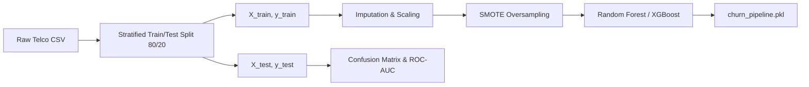
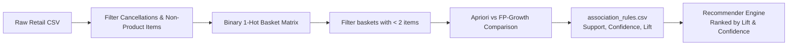

# System Architecture & Technical Specifications

**Project:** Data Mining 3-Task Production Suite (7-Day Sprint)  
**Lead Architect:** Mostafa (Team Leader & Integration Engineer)

---

## 1. High-Level System Architecture

```mermaid
flowchart TD
    subgraph Data Layer
        D1[(Raw Telco Churn CSV)]
        D2[(Raw Appliances Energy CSV)]
        D3[(Raw Online Retail CSV)]
    end

    subgraph Preprocessing Pipelines (Zero Leakage)
        P1[Classification Pipeline\nImputer + OneHot + Scaler + SMOTE]
        P2[Regression Pipeline\nTemporal Features + Time-Split + Scaler]
        P3[Association Pipeline\nCleaning + Pivot + 1-Hot Matrix]
    end

    subgraph Model Artifacts
        M1[models/classification/churn_pipeline.pkl]
        M2[models/regression/energy_pipeline.pkl]
        M3[models/association/association_rules.csv]
    end

    subgraph Unified Application Layer
        APP[Streamlit Multi-Page Web App\napp/app.py]
        PAGE1[1_Classification_Churn.py\nReal-Time Risk & ROC-AUC]
        PAGE2[2_Regression_Energy.py\nForecast & Residual Analysis]
        PAGE3[3_Association_Recommendation.py\nInteractive Cart & Rules]
    end

    D1 --> P1 --> M1 --> PAGE1 --> APP
    D2 --> P2 --> M2 --> PAGE2 --> APP
    D3 --> P3 --> M3 --> PAGE3 --> APP
```

---

## 2. Classification Module Pipeline (Customer Churn)
- **Problem Type:** Binary Classification ($y \in \{0, 1\}$).
- **Core Challenge:** Class imbalance (~73% Stay vs ~27% Churn).
- **Data Flow:**


---

## 3. Regression Module Pipeline (Energy Consumption)
- **Problem Type:** Continuous Numerical Forecasting ($y \in \mathbb{R}^+$ in Watt-hours).
- **Core Challenge:** Temporal dependency and auto-correlation.
- **Data Flow:**
```mermaid
flowchart LR
    Raw[Raw Energy CSV] --> TimeSplit[Chronological Split 80/20\nOlder 80% -> Train | Newest 20% -> Test]
    TimeSplit --> Train[X_train, y_train]
    TimeSplit --> Test[X_test, y_test]
    Train --> Scale[StandardScaler Fit]
    Scale --> Fit[XGBoost / Random Forest Regressor]
    Fit --> Pipeline[energy_pipeline.pkl]
    Test --> Metrics[MSE, RMSE, R2, Residual Plot]
```

---

## 4. Association Rules Module Pipeline (Product Recommendation)
- **Problem Type:** Market Basket Pattern Mining & Recommender Engine.
- **Core Challenge:** Combinatorial complexity and transaction cleaning.
- **Data Flow:**

